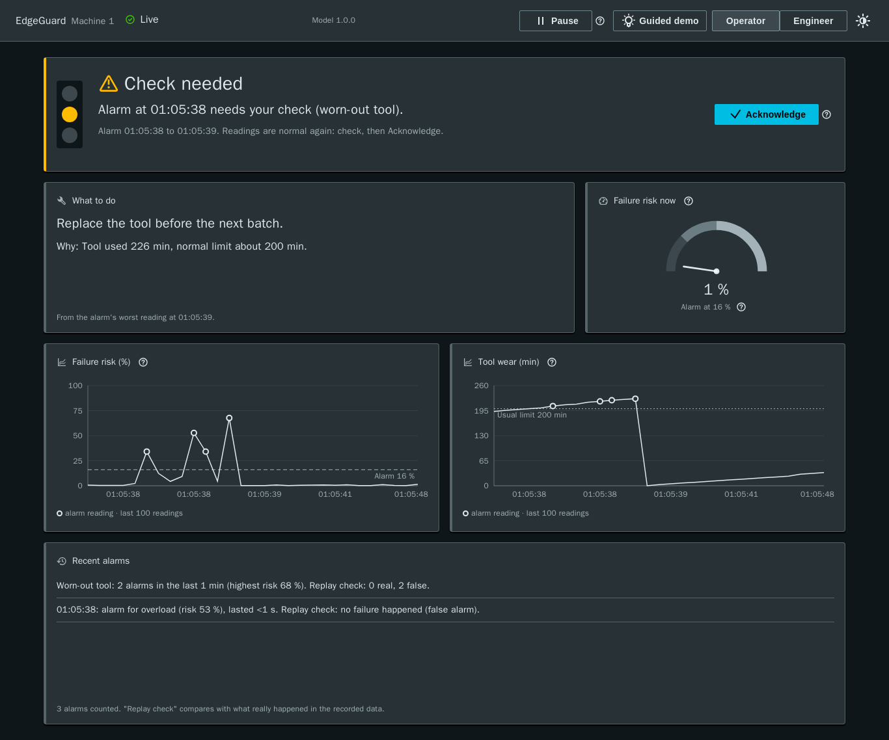
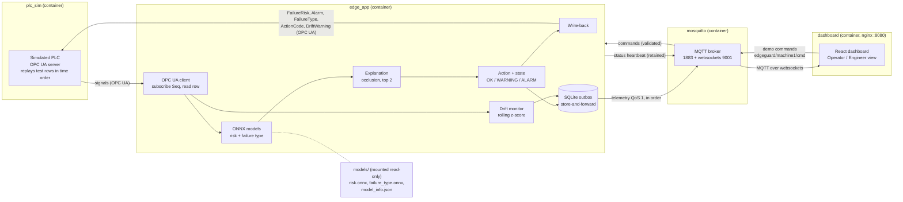
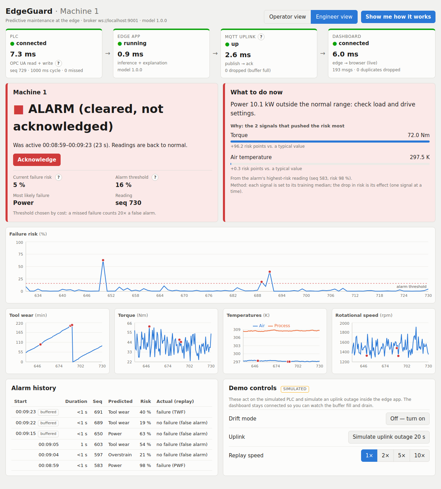
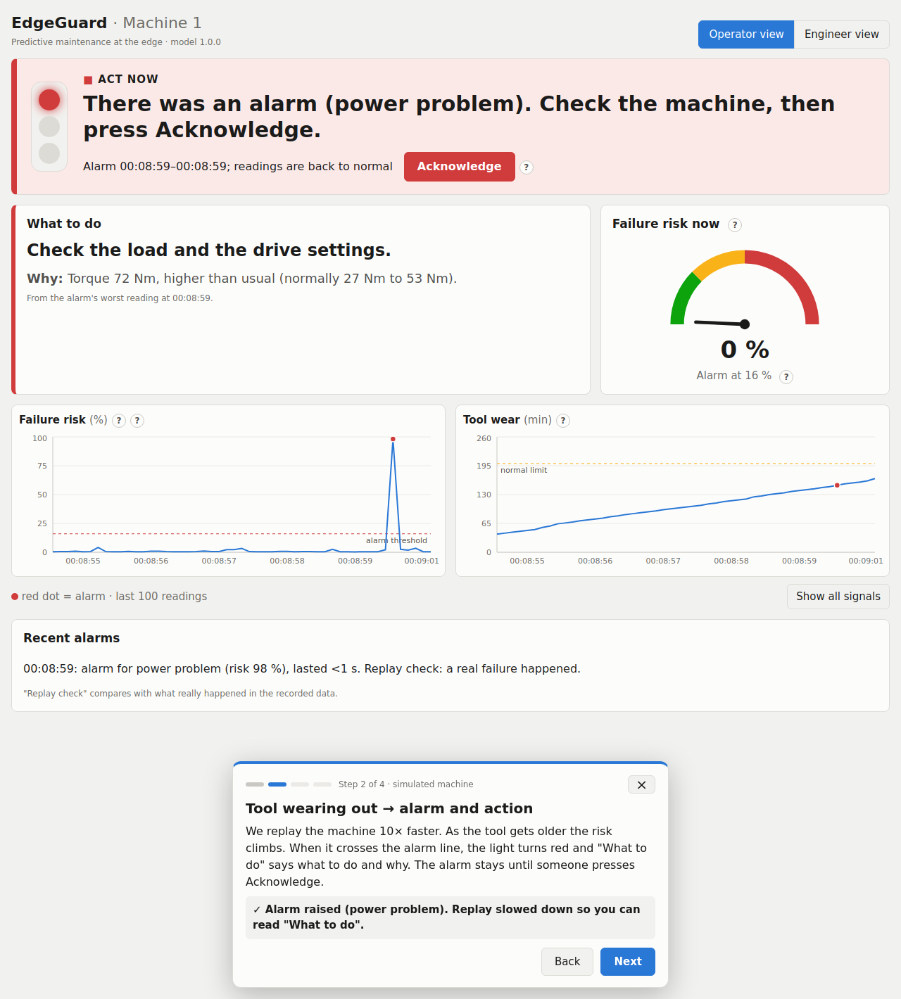

# EdgeGuard — from alarm to action

Predictive maintenance at the edge: live PLC signals over OPC UA → ONNX failure-risk and
failure-type models → an action the technician can act on, with explanation, cost-based alarm
threshold, drift warning and store-and-forward MQTT. Runs as one `docker compose` stack.



## Why this project (ME)
_TODO (ME): write in my own words._

## The problem
A maintenance technician does not need "failure probability 0.73". They need to know: is this machine going
to fail, **why**, and **what should I do now**? Machine data often stays in the PLC, failures are noticed when
the machine stops, and models stay in notebooks. Even a deployed model has three real-world problems:
1. **Alarms nobody trusts:** too many false alarms, or no explanation, so operators ignore them.
2. **Silent failure of the model** when the machine runs outside the conditions it was trained on.
3. **An unreliable network** to plant IT: data must not be lost when the link is down.

## The solution
EdgeGuard runs next to the machine and, for every PLC cycle:
1. reads the live signals from the PLC over **OPC UA** (simulated PLC here),
2. predicts the **failure risk** and the most likely **failure type** (tool wear, heat dissipation, power,
   overstrain) with two **ONNX** models,
3. turns that into an **action** ("Tool wear 209 min: replace the tool before the next batch.") plus the
   **2 signals that pushed the risk most** (occlusion with the training median),
4. alarms at a **cost-based threshold**: a missed failure costs 20 × a false alarm (configurable),
5. warns when live data **drifts** away from the training data ("prediction may be unreliable"),
6. **stores and forwards** telemetry through a local SQLite outbox when the MQTT uplink is down (in order, 0 lost),
7. writes risk, alarm, type, action code and drift flag **back to the PLC**, publishes everything over
   **MQTT**, and shows a live **dashboard** with an Operator and an Engineer view.

## Architecture


Start order in `docker compose`, each step waits for the previous healthcheck:
**mosquitto** (answers a subscribe) → **plc_sim** (OPC UA port open) → **edge_app** (fresh "running" heartbeat
with the PLC connected, `edge_app/healthcheck.py`) → **dashboard** (nginx serves the page).

| Operator view | Engineer view | Guided demo |
|---|---|---|
|  |  |  |

## Results
Time-based split by UDI (train = past, test = future; see docs/decisions.md D-20). Test set: UDI 8001–10000,
2,000 readings, 39 failures. The earlier random split is shown for comparison only (different test rows).

| Risk model (test set) | Time split, cost threshold 0.16 | Time split, default 0.50 | Old random split, cost threshold 0.22 |
|---|---|---|---|
| ROC-AUC | 0.955 | 0.955 | 0.976 |
| Recall (failures caught) | 0.85 (33/39) | 0.69 (27/39) | 0.88 (60/68) |
| Precision | 0.21 | 0.38 | 0.31 |
| F1 | 0.33 | 0.49 | 0.46 |
| False alarms / missed | 128 / 6 | 44 / 12 | 135 / 8 |

| System result | Value | Where it comes from |
|---|---|---|
| Cost-based threshold | **0.16** (validation cost 252 vs 444 at 0.50; missed = 20 × false alarm) | `training/choose_threshold.py`, [cost curve](docs/cost_curve.png) |
| Failure-type model | accuracy 0.89 on 37 test failures (small n) | `training/evaluate.py` |
| ONNX inference, 1 row | mean 0.07 ms, p95 0.09 ms (1,000 rows) | `make check-m1` |
| End-to-end latency PLC → edge → PLC | mean ~12 ms, p95 ~17 ms (100 ms cycle, 500 readings, 0 missed cycles) | `make check-m3` |
| Live precision / recall (replay) | 0.18 / 0.90 (500 readings, 10 failures) | `make check-m3` |
| Drift: false warnings on normal data | 0 % (train + validation windows, and the unseen test replay) | `training/calibrate_drift.py`, D-21 |
| Drift: detection delay (DriftMode on) | median 30, p95 36 readings; 100 % detected | D-21 |
| Uplink outage, real broker stop 20 s | 220 buffered, **0 lost, in order** | `make check-m4` |
| Uplink outage, simulated 20 s (demo) | 100 buffered, **0 lost, in order** | `make demo` |
| Full stack | 4 services healthy, telemetry on MQTT | `make check-m6` |

- **Recall by type (time split):** TWF 0.60 (n=10), PWF 1.00 (n=10), OSF 0.95 (n=21). HDF and RNF do not occur in
  the test period (all heat-dissipation failures happen in UDI 2001–8000). **RNF (random failures) is not
  predictable by definition.**
- **What the technician sees:** in the time-ordered replay, 104 alarm episodes in 2,000 readings, mean 1.6 readings
  long. Most AI4I failures are single-reading events, so the dashboard latches alarms until acknowledged.
- **Rules check:** the labels come from published rules; `docs/rules_check.png` compares them with the model (D-07).

## How to run
Needs Docker (with compose) and, for training and the demo/check scripts, Python 3.11 in `.venv` (`make venv`, needs `uv`).

```bash
make venv            # once: .venv with Python 3.11
# put the dataset at data/ai4i2020.csv (not in git), then:
make train           # models/*.onnx + model_info.json, data/{train,val,test}.csv
make up              # build + start the stack, wait until all 4 services are healthy
                     # dashboard: http://localhost:8080
make demo            # starts the stack (if needed) and runs the 2-minute scripted demo
make down            # stop everything
```

**One command after training:** `make demo` (or `docker compose up -d --build --wait` for the stack alone).
The scripted demo prints a caption per step while it drives the same demo commands as the dashboard's
guided tour: (1) normal operation, (2) 10× replay until a tool-wear alarm with action and top-2 factors,
(3) drift mode until the drift warning, (4) a 20 s simulated uplink outage with buffered / lost / in-order counts.
Open the dashboard next to the console to screen-record it.

Checks (each prints PASS or FAIL): `make check-m0` … `make check-m6`, unit tests `make test`.
`check-m3`…`check-m5` start their own PLC and edge app on the host, so run `make down` first (same ports).

### Configuration (environment variables, defaults)
In compose, `PLC_CYCLE_MS` and `DEMO_COMMANDS` can be overridden from the shell or a `.env` file; the containers
set `OPCUA_URL`, `MQTT_HOST`, `MODELS_DIR` (`/app/models`, mounted read-only) and `BUFFER_PATH` (named volume).

| Variable | Default | Used by | Meaning |
|---|---|---|---|
| `PLC_CYCLE_MS` | `1000` | plc_sim | one replayed test row (UDI order) per second; the check scripts run faster (100 ms) |
| `OPCUA_ENDPOINT` | `opc.tcp://0.0.0.0:4840/edgeguard/` | plc_sim | OPC UA server endpoint |
| `PLC_DATA` | `./data/test.csv` | plc_sim | rows to replay (compose mounts `./data/test.csv` read-only) |
| `DRIFT_TEMP_K` / `DRIFT_SPEED_RPM` | `8` / `300` | plc_sim | signal shift when `DriftMode` is on |
| `COST_MISSED_FAILURE` / `COST_FALSE_ALARM` | `20` / `1` | training | costs used to choose the alarm threshold |
| `PLC_LATENCY_LOG` | (off) | plc_sim | CSV of end-to-end latency per Seq |
| `OPCUA_URL` | `opc.tcp://localhost:4840/edgeguard/` | edge_app | PLC to connect to |
| `OPCUA_PUBLISH_MS` | `10` | edge_app | OPC UA subscription publishing interval |
| `MQTT_HOST` / `MQTT_PORT` | `localhost` / `1883` | edge_app | MQTT broker |
| `WARNING_FRACTION` | `0.5` | edge_app | WARNING when risk >= 0.5 x alarm threshold |
| `MODELS_DIR` | `./models` | edge_app | ONNX models + model_info.json |
| `DRIFT_WINDOW` | `50` | edge_app | readings in the rolling drift window |
| `DRIFT_ON` / `DRIFT_OFF` | from `model_info.json` (2.35 / 1.88) | edge_app | drift warning on / off (window-mean shift, in training std); chosen on UDI 1–8000 by `training/calibrate_drift.py` |
| `DRIFT_SIGNALS` | `AirTempK,ProcessTempK,SpeedRpm,TorqueNm` | edge_app | signals watched for drift |
| `BUFFER_PATH` | `./data/outbox.db` | edge_app | SQLite store-and-forward buffer |
| `BUFFER_MAX_ROWS` | `100000` | edge_app | buffer limit (~28 h at 1 reading/s); oldest dropped when full, count reported |
| `MQTT_CLIENT_ID` | `edgeguard-edge` | edge_app | must be unique per broker |
| `STATUS_INTERVAL_S` | `1.0` | edge_app | status heartbeat interval (PLC / edge / uplink health) |
| `DEMO_COMMANDS` | `1` | edge_app | `0` = ignore the demo command topic `edgeguard/machine1/cmd` |
| `VITE_MQTT_URL` | `ws://<page host>:9001` | dashboard | MQTT websocket URL (set at build time) |

## Honest limits
- **Semi-synthetic data.** AI4I 2020 labels were generated by simple published rules, not recorded on a real
  machine. On this data the rules alone (HDF/PWF/OSF) reach precision 1.00 (recall 0.72 vs the model's 0.85), so
  the results show the pipeline works, not how well the model would do on real machine data. RNF is random by
  definition, and the test period contains no HDF failures.
- **Simulated PLC.** The "PLC" is an asyncua OPC UA server replaying CSV rows; a real controller would offer a
  consistent data block or structure, other cycle times and real jitter.
- **Not a real Siemens Industrial Edge device.** This is a plain `docker compose` stack on Ubuntu (WSL2): no device
  management, no app store packaging, no hardware limits tested.
- **No security.** OPC UA runs with `NoSecurity`, the MQTT broker allows anonymous access without TLS, and the demo
  command topic is open to anyone on the network (`DEMO_COMMANDS=0` turns it off). A plant needs certificates,
  user login and broker ACLs.
- **Explanations are simple.** Occlusion with the training median: one signal at a time, misses interactions, and
  the model has no power feature, so a power failure is explained by torque and temperature (D-11).
- **Drift detection** looks at window means per signal only; a shift smaller than ~2.35 std is not flagged.
- **Simulated outage in the demo.** `make demo` cuts the uplink inside the edge app (same buffering code path);
  the real broker stop is tested in `make check-m4`. Alarm acknowledgement lives in one browser tab.

## What I learned (ME)
_TODO (ME): write in my own words._

## Next steps
- **M7 (a): model hot-swap over MQTT with validation and rollback.** Deploy a model v2 with **engineered features**
  (power = torque × speed × 2π/60, temperature difference, tool wear × torque). The rules check
  (`docs/rules_check.png`) shows where raw signals hurt: missed power failures sit just above the 9,000 W limit,
  missed overstrain failures just above the tool wear × torque limit; a tree on raw torque and speed can only
  approximate a product with many small steps. Goal: the explanation for seq 1614 (a real power failure, 9.01 kW,
  D-11) moves from TorqueNm + ProcessTempK to power. Cost: 3 extra inputs computed in the edge app, and explanations
  partly name derived values (see D-03, D-07).
- **M7 (b): ROS 2 Jazzy node `cell_guard`:** on alarm publish `/robot_cell/stop` (`std_msgs/Bool`).
- **Security:** OPC UA with certificates (Basic256Sha256), MQTT with TLS, users and ACLs.
- **Alarm state in the edge app / PLC** instead of the browser, so acknowledgement is shared across screens.
- **Real machine data**, and retraining when drift persists.

## Data
UCI "AI4I 2020 Predictive Maintenance Dataset" (CC BY 4.0). Not committed — place it at
`data/ai4i2020.csv`. `make train` writes the split files to `data/`; the stack mounts `data/test.csv` and
`models/` read-only, nothing from `data/` is baked into an image (`.dockerignore`).

**The dataset is semi-synthetic.** The failure labels were generated by simple published rules
(tool wear window 200–240 min, temperature difference + low speed, power range, tool wear ×
torque), not recorded from a real machine. `training/rules_check.py` compares the learned model
with these rules (`docs/rules_check.png`).
