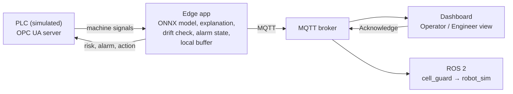

# EdgeGuard

**Predictive maintenance at the edge: from machine data to an action the technician can trust.**

EdgeGuard runs next to a machine, reads its live signals from the PLC over OPC UA, predicts failures with an ONNX model,
and sends the result back to the PLC, to an operator dashboard and to a robot cell (ROS 2). Everything starts with one
command in Docker.


## Why I built this

At the AI & Robotics Hackathon 2026 in Munich I worked on the camera side of an industrial vision challenge: capturing
and preparing images. What I did not touch was the other end: how an AI result actually reaches the machine, and what
happens when the network drops or the model sees data it was never trained on. EdgeGuard is my attempt to build that
part end to end and to measure every step.

## What it does

1. **Reads the machine.** Live signals (temperatures, speed, torque, tool wear) from a PLC over OPC UA.
2. **Predicts.** An ONNX model gives the failure risk and the most likely failure type.
3. **Tells the technician what to do.** "Tool used 209 min, normal limit about 200 min: replace the tool before the
   next batch." The reason always matches the failure type.
4. **Alarms by cost, not by habit.** A missed failure is set to cost 20 times a false alarm, and the alarm threshold
   is chosen on validation data to minimise that cost.
5. **Knows when not to trust itself.** A drift monitor warns when live data moves away from the training data.
6. **Loses no data.** If the MQTT link is down, readings are buffered locally (SQLite) and sent later in order.
7. **One alarm state for everyone.** Latch, acknowledge and cool-down live in the edge app. The PLC, every dashboard
   and the robot cell follow the same state.
8. **Stops the robot cell.** A ROS 2 node stops a simulated robot while an alarm waits for acknowledgement.

## How it works



Five containers start in order, each waiting for the previous one to be healthy:
MQTT broker → PLC simulator → edge app → ROS 2 nodes and dashboard.


*Engineer view: data flow with latency, buffer, drift, alarm rate and the robot cell. The dashboard also works in a light theme and on a phone.*

The dashboard uses [Siemens iX](https://github.com/siemens/ix), the open-source design system (MIT), in its open
"classic" theme. This project is not a Siemens product. The layout never moves: a browser test fails if any card
or button shifts by more than 2 px in any state.

## ROS 2 robot cell

A simulated robot loads parts into the machine. While an alarm is active and not yet acknowledged, it must stop.

- **cell_guard** (node) reads the alarm state and publishes `/robot_cell/stop` (true or false) on a topic.
- **robot_sim** (node) subscribes to that topic: it stops on true and loads parts again after Acknowledge.
- **Fail-safe:** if robot_sim hears nothing for 2 s, it stops by itself.

The two nodes never call each other; they only share the topic. Watch it live:
`docker compose exec ros2 bash -c "source /opt/ros/jazzy/setup.bash && ros2 topic echo /robot_cell/stop"`

## Results

Trained on the past, tested on the future (time-based split): train on the oldest 60 % of readings, choose the
threshold on the next 20 %, test on the newest 20 % (2,000 readings, 39 failures).

| Model (test set) | Value |
|---|---|
| ROC-AUC | 0.955 |
| Failures caught (recall) at the cost-based threshold 0.16 | 0.85 (33 of 39) |
| Precision at that threshold | 0.21 (many false alarms, see Limits) |
| Failure type correct | 0.89 |

| System | Value |
|---|---|
| End-to-end, PLC → edge app → back to PLC | mean ~12 ms, p95 ~17 ms, 0 missed cycles |
| Model inference per reading | < 0.1 ms on CPU |
| Network outage of 20 s | all buffered readings delivered, 0 lost, in order |
| Drift monitor | 0 % false warnings on normal data, real drift found after ~30 readings |
| Robot interlock | stops on alarm, resumes after Acknowledge, stops on lost signal |

The numbers come from the training scripts and from check scripts that print PASS or FAIL (`make check-m1` … `make check-m7b`).

## Run it

Needs Docker, Python 3.11 (via `uv`) and the dataset (see Data).

```bash
make venv     # once
make train    # trains the models and writes the data splits
make up       # starts all 5 containers, dashboard on http://localhost:8080
make demo     # optional: a scripted 2 minute demo (alarm, drift, network outage)
make down     # stops everything
make test     # unit tests
```

<details>
<summary>Configuration (environment variables)</summary>

| Variable | Default | Meaning |
|---|---|---|
| `PLC_CYCLE_MS` | `1000` | one replayed reading per second |
| `COST_MISSED_FAILURE` / `COST_FALSE_ALARM` | `20` / `1` | costs used to choose the alarm threshold |
| `ACK_COOLDOWN_S` | `60` | after Acknowledge, the same failure type does not latch again for this long |
| `DRIFT_WINDOW` | `50` | readings in the drift window |
| `DRIFT_ON` / `DRIFT_OFF` | from `model_info.json` | drift warning thresholds, calibrated on training and validation data |
| `BUFFER_MAX_ROWS` | `100000` | local buffer size (about 28 h at one reading per second) |
| `DEMO_COMMANDS` | `1` | `0` disables the demo controls (Acknowledge still works) |
| `OPCUA_URL`, `MQTT_HOST`, `MQTT_PORT` | local defaults | connections |

</details>

## Limits

- **Too many alarms.** The low threshold catches most failures but gives about one alarm every 12 s on the replay,
  most of them false. Real plants aim for a few alarms per hour (ISA-18.2). Cool-down and grouping reduce the noise;
  the real fix is a better model (see Next steps).
- **The replay is compressed.** One reading stands for one production cycle and is replayed every second, so months
  of machine life pass in minutes. A real machine fails far less often.
- **Semi-synthetic data.** The AI4I 2020 failure labels were generated from simple rules. The results show that the
  pipeline works, not how the model would do on real machine data.
- **Simulated PLC.** A Python OPC UA server replays the data. A real controller has other cycle times and jitter.
- **Not a real Industrial Edge device.** A plain Docker Compose stack: no device management or app packaging.
- **No security.** OPC UA and MQTT run without certificates, login or encryption. A plant needs all three.
- **Not a safety function.** The robot interlock shows the logic only. Real robot safety needs a safety PLC.
- **Alarm state is kept in memory.** A restart of the edge app forgets latched alarms.

## What I learned

- **A random split hid how hard the problem is.** Switching to a time-based split lowered every score, but the new
  numbers are the honest ones.
- **A good threshold on paper can flood the operator.** Choosing it by cost caught 85 % of failures, and the dashboard
  showed what that means in practice: alarms every few seconds. Alarm handling is as important as the model.
- **The explanation found a weakness in the model.** For a real power failure it blamed temperature, because the model
  has no power feature. Showing the reason made the problem visible.
- **Calibrate on the right data.** My first drift threshold, set on one calm period, would have warned 23 % of the
  time in the hot season. Calibrating over both seasons brought it to 0 %.
- **Keep one source of truth.** With the alarm logic in the browser, two screens disagreed and the robot ignored the
  cool-down. Moving it into the edge app fixed both.

## Next steps

- **Model v2 with physics features** (power = torque × speed, temperature difference, tool wear × torque), deployed
  while the app keeps running, with automatic rollback. Goal: far fewer false alarms.
- **Security:** OPC UA certificates, MQTT with TLS and user accounts.
- **Several machines** on one edge device, and real machine data.

## Data

UCI "AI4I 2020 Predictive Maintenance Dataset" (CC BY 4.0). It is not in this repository: download it and place it
at `data/ai4i2020.csv`. `training/rules_check.py` compares the model with the rules that generated the labels
([plot](docs/rules_check.png)).

Design decisions and their trade-offs are logged in [docs/decisions.md](docs/decisions.md).
